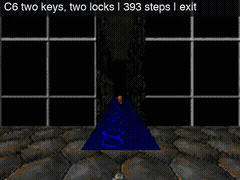
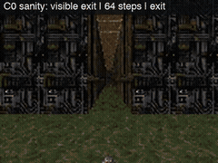
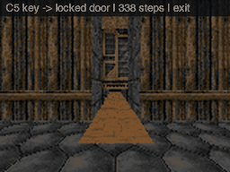
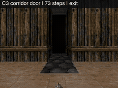
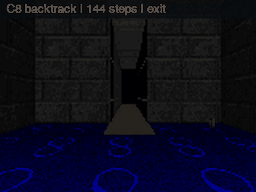
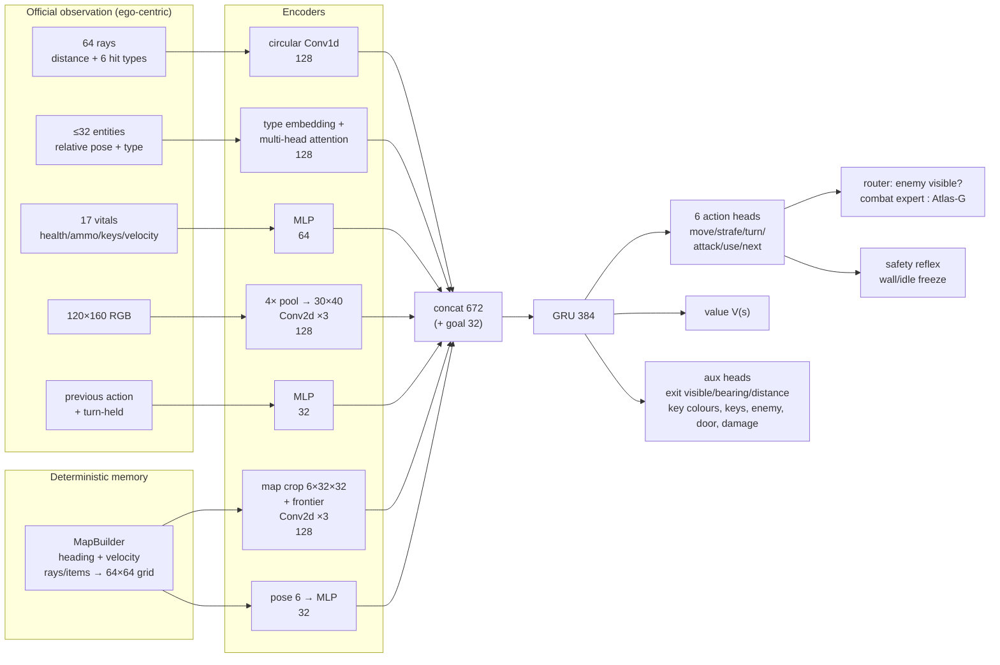
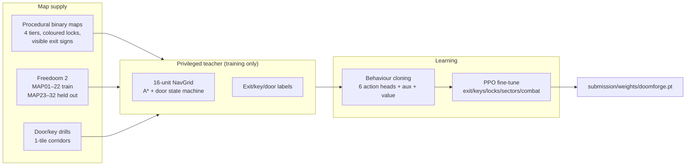

<div align="center">

# DoomForge

**Can a 1.8 M-parameter network learn to play unseen DOOM levels on one CPU thread?**

[](https://github.com/Science-wizard/DoomForge)
[](#validation)
[](https://www.python.org/)
[](https://vizdoom.farama.org/)
[](https://pytorch.org/)
[](#validation)
[](#repository)



<sub>Shipped hybrid on C6: fetch the red key, open the red door, fetch the blue key,
open the blue door, reach the exit — 393 decisions, ego-centric observations only.</sub>

</div>

---

## Watch it play

Six unedited episodes from the shipped agent on held-out validation maps. Every
clip is the official `DoomAgent` path; the MP4 is higher quality, the GIF is the
inline preview.

| | |
|---|---|
| <br>**C0 sanity** · 64 steps · exit · [MP4](docs/assets/videos/C0_sanity_10000.mp4) | <br>**C5 key → locked door** · 268 steps · [MP4](docs/assets/videos/C5_key_lock_10000.mp4) |
| <br>**C6 two keys, two locks** · 393 steps · [MP4](docs/assets/videos/C6_two_key_10000.mp4) | <br>**C2 arena combat** · 218 steps · exit · [MP4](docs/assets/videos/C2_arena_10001.mp4) |
| <br>**C3 corridor door** · 73 steps · exit · [MP4](docs/assets/videos/C3_corridor_door_10000.mp4) | <br>**C8 backtrack** · 400 steps · exit · [MP4](docs/assets/videos/C8_backtrack_10000.mp4) |

<sub>Prefer real video? Open the [MP4 gallery](docs/assets/videos/README.md) with inline players.</sub>

<sub>Recorded with `tools/record_videos.py`; metadata and exact map IDs are in
[`docs/assets/videos/clips.json`](docs/assets/videos/clips.json). These are
illustrative successes, not a cherry-picked score: the full per-category table,
including failures, is in [`docs/RESULTS.md`](docs/RESULTS.md).</sub>

---

## The challenge

Track 1 asks for an agent that plays **unseen** DOOM maps zero-shot through the official
wrapper: 64 ego-centric raycasts, up to 32 visible entities, 17 vitals values, a 120×160
RGB frame, and a 9-bit action every 4 game tics. The sandbox gives **one CPU thread**,
2 GB VRAM, 8 GB RAM and **40 ms per decision**.

Two things make this harder than a standard RL benchmark:

1. **The exit is invisible to the structured observations.** There is no exit hit type
   and no exit entity. It must be learned from pixels.
2. **Key and lock colour is hidden until pickup.** Every key is `key`; every lock is
   `locked_door`. Colour must come from pixels, or the agent must remember and retry.

The scoring is non-binary and tier-weighted: exit ≫ keys/doors > unique sectors > kills,
minus damage and early death. The exact weights are hidden.

---

## What DoomForge does

Module-by-module reference: [`docs/ARCHITECTURE.md`](docs/ARCHITECTURE.md).



- **No pixels at full resolution.** RGB is pooled 4× to 30×40; that is enough for a bright
  exit sign or a blue/red/yellow door, and costs 3.6 KB/frame.
- **Attention over entities**, not a flattened vector: permutation-invariant and works
  with zero to 32 entities.
- **Factorised actions**: 3×3×3×2×2×2 = 216 meaningful joint actions instead of 512
  mostly-nonsensical bit combinations. Still a valid `MultiBinary(9)`.
- **Deterministic memory**: heading from the measured turn table, translation from ego
  velocity, rays and item sightings projected into a 64×64 allocentric grid. This is
  perception, not planning — no A*, BFS, or rule tree in the submitted agent.
- **Learned goal interface (Atlas-G)**: a 6th frontier map channel and a goal head
  predict the teacher's current objective as an ego-relative 8-vector + type; the
  goal vector is fused back into the policy. At inference the goal is predicted from
  observations only.
- **Perception-routed hybrid**: the shipped agent runs Atlas-G for navigation, keys
  and doors, and the frozen Phase-2 arena expert when an enemy is visible. Both nets
  see every observation; a 16-decision hysteresis stops flapping. A small
  observation-only reflex escapes wall/idle freezes. No privileged state.

### Auxiliary heads (the “see what the observations hide” trick)

Trained from privileged map geometry during training, used only to shape the encoder:

| Head | Target |
|---|---|
| exit visible | exit linedef in FOV ±55° with grid line-of-sight |
| exit bearing | 13 classes: 12 angle bins + not visible |
| exit distance | 6 bins: 256/512/768/1024/1400 units + not visible |
| key colours | 6-way multi-label (blue/yellow/red card and skull) |
| keys held | six flags from vitals |
| enemy visible / door ahead | self-supervised from entities/rays |
| damage next 8 | `max(0, hp[t] − hp[t+8]) / 100` |

---

## Methodology

The full end-to-end method — data generation, teacher, BC, DAgger, PPO, suite,
gates, probes, compute choices and limitations — is in
[`docs/METHODOLOGY.md`](docs/METHODOLOGY.md). The short version:

1. **Maps**: a procedural binary-map generator with four layout tiers, coloured
   locks, visible exit signs, plus 32 Freedoom maps split train/val/test.
2. **Teacher**: a training-only privileged expert (16-unit nav grid, A* with door
   costs, key gating, door state machine, circle-strafing combat) labels every
   demonstration and every auxiliary target.
3. **Behaviour cloning**: 128-step recurrent windows, six action heads, exit and
   key-colour auxiliary heads, a learned goal head and the 6-channel frontier map.
4. **Suite-driven improvement**: PPO samples the 14-category train split with a
   30/50/20 mastered/current/hardest mix and key-potential shaping; DAgger labels
   student failure states (the unbalanced run is documented as a dead end).
5. **Measurement**: fast paired gate (5 maps/category × 1 seed) with bootstrap
   CIs; full gate (30 × 5) reserved for promotion; test/OOD every look logged.

Architecture details, including the perception router and the anti-freeze reflex,
are in [`docs/ARCHITECTURE.md`](docs/ARCHITECTURE.md).

---

## Training pipeline



The teacher reads `privileged_state()` (position, keys, sector heights) and static WAD
geometry. It never runs at evaluation, and `submission/` never imports it. Training-time
scaffolding is explicitly allowed by the rules.

**Reward used by PPO (proxy):** exit +10, key +3, locked door +3, door +0.5, new sector
+0.3, new cell +0.01 (capped), kill +0.6, damage −0.01/HP, early death penalty,
potential-based objective shaping. Every component is logged separately; the official
weights are hidden.

---

## Results

> Proxy numbers from `training/suite` (70 episodes, held-out seeds 10 000+) and
> `training/bench.py` (seeds 30 000+, Freedoom MAP23–32). The official scorer is
> hidden; these are not claimed as leaderboard scores.

### Phase 3 diagnostic suite

| Category | PPO-25 | Atlas-G | **Hybrid + reflex** |
|---|---:|---:|---:|
| C0 sanity | 0% | 100% | **100%** |
| C1 duel | 10% | 0% | **20%** |
| C2 arena | 80% | 60% | 80% |
| C3 corridor door | 0% | 0% | **100%** |
| C4 room door | 0% | 20% | 0% (test 60%) |
| C5 key → locked door | 0% | 100% | **100%** |
| C6 two keys, two locks | 0% | 0% | **100%** |
| C8 backtrack | 0% | 20% | **40%** |
| C7/C9–C13 | 0% | 0% | 0% |
| **Tier-weighted proxy** | **+1.18** | **+3.07** | **+6.20** |
| 95% CI | +0.76…+1.66 | +2.39…+3.75 | **+5.46…+6.98** |

Paired delta vs PPO-25: **+5.03** (95% CI +3.08…+7.25), gate **PROMOTE**. The
same checkpoint scores **+6.40** (CI +5.72…+7.08) on the untouched test split
(paired delta +5.51, CI +3.59…+7.69).
The hybrid runs Atlas-G for navigation/keys/doors and the frozen Phase-2 PPO-25
whenever an enemy is visible; an observation-only reflex escapes wall/idle
freezes. Full tables and dead ends: [`docs/RESULTS.md`](docs/RESULTS.md).

### Phase 2 official-style bench (shipped fallback comparison)

| Split | Exit | Keys | Doors | Unique sectors | Proxy |
|---|---:|---:|---:|---:|---:|
| Generated tier 1 (combat) | **6/8** | 0 | 0 | 100% | **+8.20** |
| Generated tier 2 (exploration) | 0/8 | 0 | 1 | 6.1% | **+0.48** |
| Generated tier 3 (key → lock) | 0/8 | 0 | 1 | 4.2% | −0.03 |
| Generated tier 4 (gauntlet) | 0/8 | 0 | 5 | 2.0% | −0.32 |
| Door drills | 0/8 | 0 | 0 | 47.5% | +0.60 |
| Freedoom MAP23–32 (unseen) | 0/10 | 0 | — | 1.6% | +0.36 |

**Eight maps per generated tier**, fixed bench seeds `30000+` (never used for training),
one engine seed, Freedoom MAP23–32 held out. This is the honest number; the earlier
“2/2” was a two-map eval and is superseded. A separate drill-only branch reaches
**6/8 door drills** but trades away arena exits (see `progress.md`).

The Phase-2 fallback is **PPO-25** (25.6k steps from the arena specialist): tier-1
**6/8** exits with 19 kills. In Phase 3 the shippable checkpoint is the **hybrid**
(Atlas-G + PPO-25 + reflex): suite **+5.80** vs PPO-25's +1.18, with key
categories 0% → 100% and no lost arena exits. The single Atlas-G checkpoint reaches
suite +3.07, so it ships only as the navigation expert inside the router.

The full lab log is in [`progress.md`](progress.md), the benchmark method and every
per-checkpoint row is in [`docs/RESULTS.md`](docs/RESULTS.md), and the 24-hour plan and gates
are in [`PLAN.md`](PLAN.md).

---

## Validation

```text
✓ Repository size (tracked files): 43.3 MB of 1.0 GB
✓ requirements.txt: no extra packages
✓ DoomAgent interface: __init__, reset, act
✓ Initialization: 0.4 s (limit 60 s)
✓ Episode on 'two_rooms.wad:MAP01': 195 steps, exit reached
✓ Step latency: p50 1.6 ms, p99 2.2 ms, max 6 ms (limit 5 s/act)
! CPU limit: not pinnable on macOS (Linux-only check)
! Peak RAM: not measurable on macOS (needs /proc)
PASSED
```

Official limits: 2 GB VRAM, 8 GB RAM, 1 CPU thread, 60 s init, 10 s reset, 10 s first
act, 5 s any act, 40 ms average compute per decision. Our margins are >40× on latency
and >8× on RAM (estimated <1 GB).

---

## Documentation map

| Document | What it covers |
|---|---|
| [`docs/METHODOLOGY.md`](docs/METHODOLOGY.md) | end-to-end method: data, teacher, BC/DAgger/PPO, suite, gates, limitations |
| [`docs/ARCHITECTURE.md`](docs/ARCHITECTURE.md) | network modules, Atlas-G goal head/frontier map, hybrid router, reflex, parameter table |
| [`docs/RESULTS.md`](docs/RESULTS.md) | every checkpoint and every category, including dead ends |
| [`docs/EVALUATION.md`](docs/EVALUATION.md) | official constraints and the diagnostic suite protocol |
| [`docs/CONTRACT.md`](docs/CONTRACT.md) | the exact observation/action contract and interface |
| [`docs/RULES.md`](docs/RULES.md) | competition and fair-play rules we operate under |
| [`docs/SUBMISSION.md`](docs/SUBMISSION.md) | submission checklist, LFS, final artifact layout |
| [`docs/PHASE3_PROPOSAL.md`](docs/PHASE3_PROPOSAL.md) | approved Atlas-G / 14-category proposal |
| [`docs/RESEARCH.md`](docs/RESEARCH.md) | short research notes on environment findings |
| [`research.md`](research.md) | 19.7k-word literature and architecture review |
| [`PLAN.md`](PLAN.md) | plan of record and gates (Revision 2 + Phase 3 addendum) |
| [`progress.md`](progress.md) | dated lab log, every measured result and dead end |
| [`training/README.md`](training/README.md) | training entry points and data layout |
| [`training/suite/README.md`](training/suite/README.md) | 14 categories, splits, metrics, probes, commands |
| [`docs/brief/DoomForge_Brief.pdf`](docs/brief/DoomForge_Brief.pdf) | 2-page submission brief ([HTML source](docs/brief/brief.html)) |
| [`docs/assets/videos/clips.json`](docs/assets/videos/clips.json) | video metadata and exact map IDs |
| [`NOTICE.md`](NOTICE.md) · [`LICENSE`](LICENSE) | attribution and license |

---

## Reproduce

```bash
# 1. environment (Python 3.13 + uv)
uv sync

# 2. official validator
uv run python validate.py

# 3. real maps (32 Freedoom maps × 3 variants)
uv run python -m training.maps.prepare_freedoom

# 4. demonstrations (navigation, arenas, drills, keys, backtrack)
uv run python -m training.collect --episodes 250 --source gen --no-doors --no-monsters
uv run python -m training.collect --episodes 150 --source gen --tier 1
uv run python -m training.collect --episodes 150 --source drill --drill-doors 2 --drill-key
uv run python -m training.collect --episodes 150 --source keychain
uv run python -m training.collect --episodes 150 --source backtrack

# 5. behaviour cloning (Atlas-G)
uv run python -m training.bc --data training/data/demos_v2_nav,... --epochs 4

# 6. diagnostic suite (train once, then fast val gate)
uv run python -m training.suite.generate --split train --n 20
uv run python -m training.suite.generate --split val --n 10
uv run python -m training.suite.run --agent --split val --out training/runs/suite/val_fast --fast
uv run python -m training.suite.compare --baseline <baseline_run> --candidate <candidate_run>

# 7. PPO fine-tune (suite curriculum)
uv run python -m training.ppo --init training/runs/bc_v5/ckpt.pt --suite --updates 80
```

The agent is `submission/agent.py`; weights are `submission/weights/doomforge.pt`
(Atlas-G) and `submission/weights/combat.pt` (PPO-25), both Git LFS. The scorer mounts
the repo read-only and gives the agent only the observation dictionary.

---

## Repository map

```
submission/
  agent.py          DoomAgent: load, reset, act (sanitised, argmax, CPU-safe)
  model.py          Baseline A/B+ network
  mapmem.py         deterministic ego-motion map (perception only)
  weights/          Git LFS: Atlas-G + combat specialist
training/
  maps/             procedural generator, drills, Freedoom preparation
  teacher/          privileged A*/frontier expert (TRAINING ONLY)
  collect.py        demonstrations + exit/key/door synthetic labels
  dagger.py         student-state relabelling
  bc.py             behaviour cloning
  ppo.py            recurrent PPO
  evaluate.py       proxy leaderboard, sector coverage, replays
  coverage.py       sector lookup via sector_polygons()
  splits.py         frozen train/val/OOD/Freedoom splits
docs/
  ARCHITECTURE.md   module reference and data flow
  RESEARCH.md       environment findings, algorithm choices, references
  brief/            2-page PDF brief
PLAN.md             Revision 2 plan (24-hour cut)
progress.md         live lab log
validate.py         official validator (untouched)
```

---

## Compliance

- Built from `Reinforce-SST/devforge-doom-template`; `env/`, `validate.py` and the
  `DoomAgent` contract are untouched.
- No Dockerfile, no CI/CD, no network or engine access at inference, no writes outside
  `/tmp`.
- Every action is a forward pass of trained parameters plus a deterministic,
  observation-only anti-freeze reflex. The teacher, A*, BFS and door state machines
  live only under `training/` and are never imported by `submission/`.
- Weights use Git LFS; data shards and checkpoints from intermediate runs are gitignored;
  the repository is ≪ 1 GB.
- Deterministic argmax; identical actions on repeat runs.

---

## Phase 3 status and next

Shipped: the perception-routed hybrid (Atlas-G + PPO-25 + corridor-door
specialist + reflex), val **+6.20**, test **+6.40**, validator PASS. Known gaps,
in priority order:

1. **C7/C9–C13** (exploration, ambush, scarce ammo, gauntlet, Freedoom, OOD) are still
   0% exits. The next training round should add exploration demonstrations and
   resource-aware combat; a full 30-map × 5-seed test is reserved for that candidate.
2. **C4 room door** is 0% on validation and 60% on test; the corridor specialist does
   not generalise to room-wall doors. A room-door specialist is the next small expert.
3. **Learned router**: replace the enemy-visibility rule with a small gate trained on
   the suite's category outcomes; keep the rule as the fallback and the gate must beat
   it on the paired gate.
4. **Scan matching / event tokens** only if the probes show drift or memory-wipe
   sensitivity; the current fast suite does not.
5. **Submission**: flip the repository to public and send the URL before the deadline.

<div align="center">
<sub>Built during Yugaantar DevForge 2026. DOOM is a trademark of id Software; Freedoom is BSD-licensed.</sub>
</div>
