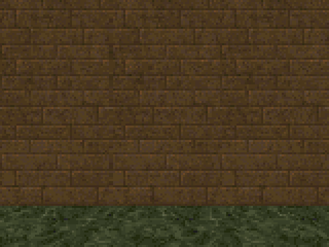
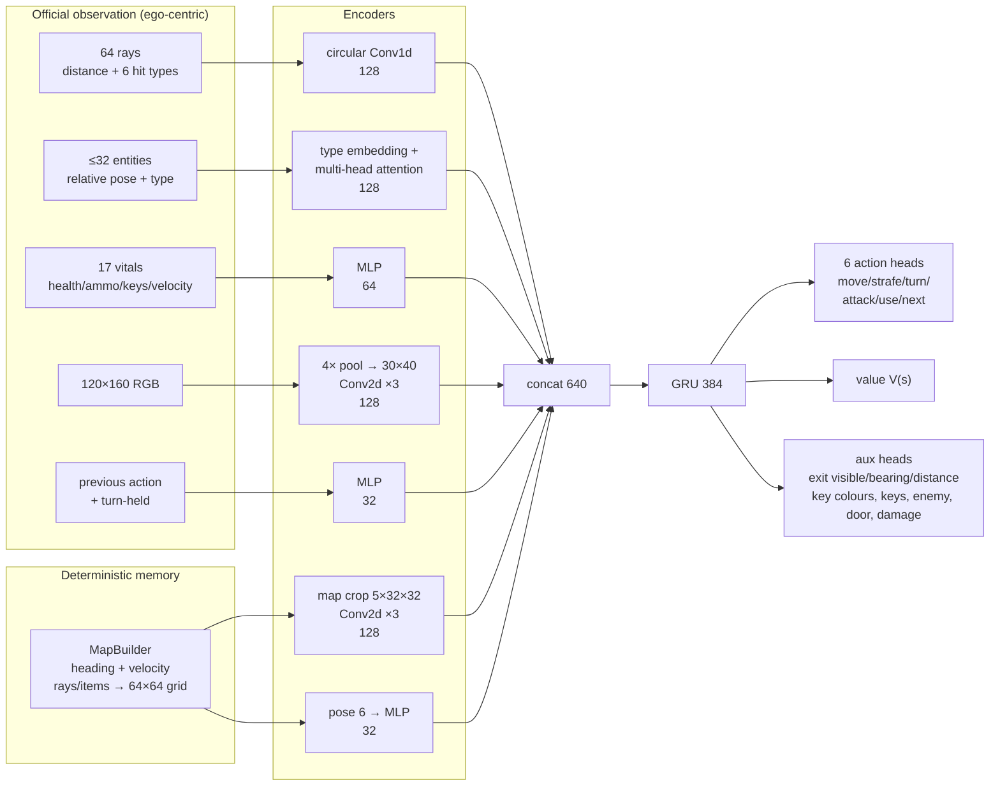
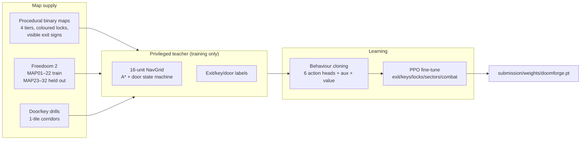
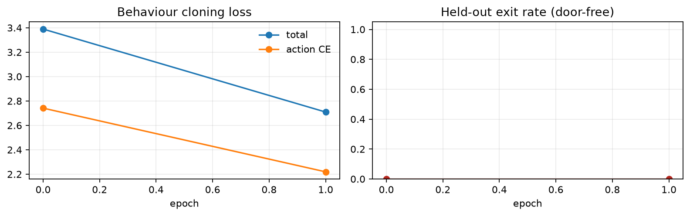
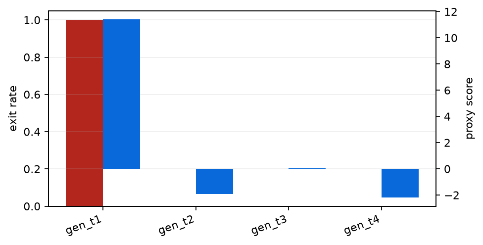

<div align="center">

# DoomForge

**Can a 1.8 M-parameter network learn to play unseen DOOM levels on one CPU thread?**

[](https://github.com/Science-wizard/DoomForge)
[](#validation)
[](https://www.python.org/)
[](https://vizdoom.farama.org/)
[](https://pytorch.org/)
[](#validation)
[](#repository)



<sub>A trained agent in the official `doom_env` wrapper — ego-centric observations only.</sub>

</div>

---

## The challenge

Track 1 asks for an agent that plays **unseen** DOOM maps zero-shot through the official
wrapper: 64 ego-centric raycasts, up to 32 visible entities, 17 vitals values, a 120×160
RGB frame, and a 9-bit action every 4 game tics. The sandbox gives **one CPU thread**,
2 GB VRAM, 8 GB RAM and **40 ms per decision**.

Two things make this harder than a standard RL benchmark:

1. **The exit is invisible to the structured observations.** There is no exit hit type
   and no exit entity. It must be learned from pixels.
2. **Key and lock colour is hidden until pickup.** Every key is `key`; every lock is
   `locked_door`. Colour must come from pixels, or the agent must remember and retry.

The scoring is non-binary and tier-weighted: exit ≫ keys/doors > unique sectors > kills,
minus damage and early death. The exact weights are hidden.

---

## What DoomForge does



- **No pixels at full resolution.** RGB is pooled 4× to 30×40; that is enough for a bright
  exit sign or a blue/red/yellow door, and costs 3.6 KB/frame.
- **Attention over entities**, not a flattened vector: permutation-invariant and works
  with zero to 32 entities.
- **Factorised actions**: 3×3×3×2×2×2 = 216 meaningful joint actions instead of 512
  mostly-nonsensical bit combinations. Still a valid `MultiBinary(9)`.
- **Deterministic memory**: heading from the measured turn table, translation from ego
  velocity, rays and item sightings projected into a 64×64 allocentric grid. This is
  perception, not planning — no A*, BFS, or rule tree in the submitted agent.

### Auxiliary heads (the “see what the observations hide” trick)

Trained from privileged map geometry during training, used only to shape the encoder:

| Head | Target |
|---|---|
| exit visible | exit linedef in FOV ±55° with grid line-of-sight |
| exit bearing | 13 classes: 12 angle bins + not visible |
| exit distance | 6 bins: 256/512/768/1024/1400 units + not visible |
| key colours | 6-way multi-label (blue/yellow/red card and skull) |
| keys held | six flags from vitals |
| enemy visible / door ahead | self-supervised from entities/rays |
| damage next 8 | `max(0, hp[t] − hp[t+8]) / 100` |

---

## Training pipeline



The teacher reads `privileged_state()` (position, keys, sector heights) and static WAD
geometry. It never runs at evaluation, and `submission/` never imports it. Training-time
scaffolding is explicitly allowed by the rules.

**Reward used by PPO (proxy):** exit +10, key +3, locked door +3, door +0.5, new sector
+0.3, new cell +0.01 (capped), kill +0.6, damage −0.01/HP, early death penalty,
potential-based objective shaping. Every component is logged separately; the official
weights are hidden.

---

## Results

> Proxy numbers from `training/evaluate.py` on held-out seeds and Freedoom MAP23–32.
> The official scorer is hidden; these are not claimed as leaderboard scores.

| Split | Exit | Keys | Unique sectors | Proxy |
|---|---:|---:|---:|---:|
| Generated tier 1 (combat) | **2/2** | 0 | 100% | **+11.4** |
| Generated tier 2 (exploration) | 0/2 | 0 | 5.9% | −1.9 |
| Generated tier 3 (key → lock) | 0/2 | 0 | 3.6% | 0.0 |
| Generated tier 4 (gauntlet) | 0/2 | 0 | 2.1% | −2.2 |
| Freedoom MAP23–32 (unseen) | not run | — | — | — |
| Door drills *(research branch, not shipped)* | 4/4 | 1 | 100% | +11.7 |

The shipped checkpoint is the **tier-1 model** (`bc_map2` epoch 0). A separate
drill-only fine-tune (`bc_use`) learned doors and keys (4/4 on 1-door and key drills)
but catastrophically forgot arena exits; the balanced fine-tune (`bc_mix`) did neither.
This is the concrete Phase-2 problem: replay/distillation or PPO must retain both.

<p align="center">
  
  
</p>

### What the experiments found (Phase 1)

- **Turn prediction is the bottleneck.** With a global A* teacher, teacher-forced turn
  accuracy stayed at **43%** (chance 33%) after four BC epochs: the turn label depends on
  a global waypoint the agent cannot see. Move/strafe/attack reached 86/76/92%.
- **A map fixes part of it.** Adding a deterministic pose + visited map raised turn
  accuracy to ~49% after one epoch and cut heading drift from 63° to 16° over 250 steps.
- **Odometry matters.** The first map version collapsed the measured turn table to a
  constant 14.06°/decision and integrated velocity one step late; correcting both cut
  position error from 907 to 361 units and heading error from 63° to 16°.
- **Tier 1 works.** The first map-aware checkpoint exits **2/2** held-out arenas, with
  four kills in one, at 100% sector coverage.
- **Doors were the missing data, not the missing model.** The first BC set contained
  zero closed doors, so the USE head learned “never use” and every tier-2 run stopped at
  the first door. 360/360 reliable drill episodes (1 door, door+key, two doors) were
  added; the USE head is now weighted 10× on door-adjacent frames.
- **The validator is not the score.** It passes with p50 1.0 ms; skill is the open problem.

The full lab log is in [`progress.md`](progress.md); the 24-hour plan and gates are in
[`PLAN.md`](PLAN.md).

---

## Validation

```text
✓ Repository size (tracked files): 7.5 MB of 1.0 GB
✓ requirements.txt: no extra packages
✓ DoomAgent interface: __init__, reset, act
✓ Initialization: 0.4 s (limit 60 s)
✓ Episode on 'two_rooms.wad:MAP01': 525 steps, tick cap
✓ Step latency: p50 1.0 ms, p99 1.9 ms, max 3 ms (limit 5 s/act)
! CPU limit: not pinnable on macOS (Linux-only check)
! Peak RAM: not measurable on macOS (needs /proc)
PASSED
```

Official limits: 2 GB VRAM, 8 GB RAM, 1 CPU thread, 60 s init, 10 s reset, 10 s first
act, 5 s any act, 40 ms average compute per decision. Our margins are >40× on latency
and >8× on RAM (estimated <1 GB).

---

## Reproduce

```bash
# 1. environment (Python 3.13 + uv)
uv sync

# 2. official validator
uv run python validate.py

# 3. real maps (32 Freedoom maps × 3 variants)
uv run python -m training.maps.prepare_freedoom

# 4. demonstrations (navigation, arenas, drills)
uv run python -m training.collect --episodes 400 --source gen --no-doors --no-monsters
uv run python -m training.collect --episodes 150 --source gen --tier 1
uv run python -m training.collect --episodes 200 --source drill

# 5. behaviour cloning
uv run python -m training.bc --data training/data/demos_all --epochs 4

# 6. held-out evaluation
uv run python -m training.evaluate --ckpt training/runs/bc_map2/ckpt.pt --suite all

# 7. PPO fine-tune (next phase)
uv run python -m training.ppo --init training/runs/bc_map2/ckpt.pt --updates 200
```

The agent is `submission/agent.py`; weights are `submission/weights/doomforge.pt`
(Git LFS). The scorer mounts the repo read-only and gives the agent only the observation
dictionary.

---

## Repository map

```
submission/
  agent.py          DoomAgent: load, reset, act (sanitised, argmax, CPU-safe)
  model.py          Baseline A/B+ network
  mapmem.py         deterministic ego-motion map (perception only)
  weights/          Git LFS checkpoint
training/
  maps/             procedural generator, drills, Freedoom preparation
  teacher/          privileged A*/frontier expert (TRAINING ONLY)
  collect.py        demonstrations + exit/key/door synthetic labels
  dagger.py         student-state relabelling
  bc.py             behaviour cloning
  ppo.py            recurrent PPO
  evaluate.py       proxy leaderboard, sector coverage, replays
  coverage.py       sector lookup via sector_polygons()
  splits.py         frozen train/val/OOD/Freedoom splits
docs/
  ARCHITECTURE.md   module reference and data flow
  RESEARCH.md       environment findings, algorithm choices, references
  brief/            2-page PDF brief
PLAN.md             Revision 2 plan (24-hour cut)
progress.md         live lab log
validate.py         official validator (untouched)
```

---

## Compliance

- Built from `Reinforce-SST/devforge-doom-template`; `env/`, `validate.py` and the
  `DoomAgent` contract are untouched.
- No Dockerfile, no CI/CD, no network or engine access at inference, no writes outside
  `/tmp`.
- Every action is a forward pass of trained parameters. The teacher, A*, BFS and door
  state machines live only under `training/` and are never imported by `submission/`.
- Weights use Git LFS; data shards and checkpoints from intermediate runs are gitignored;
  the repository is ≪ 1 GB.
- Deterministic argmax; identical actions on repeat runs.

---

## What is next (Phase 2)

1. **PPO** from the BC checkpoint with the map-aware policy, 8 workers, curriculum
   drills → tier 2 → tier 2–3 with monsters → full tier 2–4 + Freedoom train.
2. **Event tokens** for locked doors/keys/exit cues, with a memory-wipe ablation.
3. **Translation-only scan matching** to hold drift under one cell per 200 steps.
4. **Held-out report** on Freedoom MAP23–32 and OOD generator seeds; freeze at the
   deadline.

<div align="center">
<sub>Built during Yugaantar DevForge 2026. DOOM is a trademark of id Software; Freedoom is BSD-licensed.</sub>
</div>
