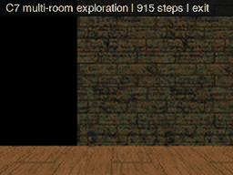
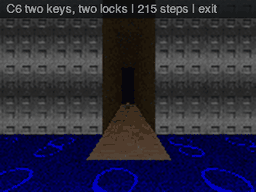
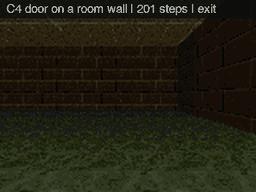
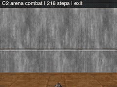
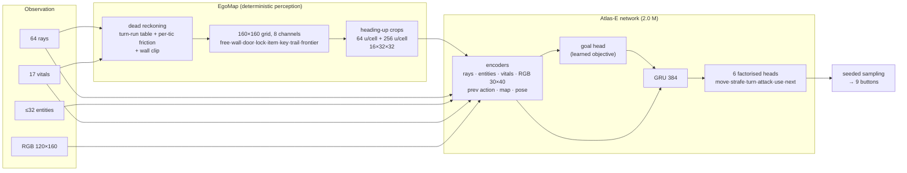
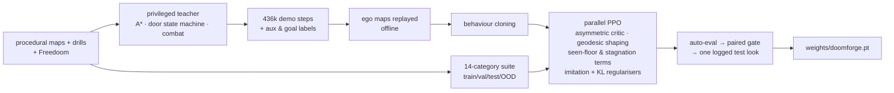

<div align="center">

# DoomForge

**A 2 M-parameter recurrent agent that explores unseen DOOM levels, fetches keys,
opens locks and fights, deciding in 1.6 ms on one CPU thread.**

[](https://github.com/Science-wizard/DoomForge)
[](#validation)
[](https://www.python.org/)
[](https://vizdoom.farama.org/)
[](https://pytorch.org/)
[](#validation)



<sub>Unseen multi-room validation map (8–13 rooms per map in this category): the agent opens doors room by room, maps the
level as it goes and reaches the hidden exit after 915 decisions. Ego-centric
observations only.</sub>

</div>

---

## Watch it play

Unedited episodes through the official `DoomAgent` on held-out validation maps.

| | |
|---|---|
| <br>**Two keys, two locks** · 215 decisions · exit · [MP4](docs/assets/videos/C6_two_key_10001.mp4) | <br>**Door on a room wall** · 201 decisions · exit · [MP4](docs/assets/videos/C4_room_door_10000.mp4) |
| <br>**Key → locked door** · 338 decisions · exit · [MP4](docs/assets/videos/C5_key_lock_10000.mp4) | <br>**Key behind the spawn** · 144 decisions · exit · [MP4](docs/assets/videos/C8_backtrack_10000.mp4) |
| <br>**Arena combat** · 125 decisions · 3 kills · exit · [MP4](docs/assets/videos/C2_arena_10001.mp4) | <br>**Multi-room exploration** · 915 decisions · exit · [MP4](docs/assets/videos/C7_exploration_10000.mp4) |

<sub>These are illustrative successes; the full per-category table, failures
included, is in [`docs/RESULTS.md`](docs/RESULTS.md).</sub>

---

## The challenge

Track 1 scores an agent on **unseen** DOOM maps through the official wrapper:
64 ego-centric raycasts, up to 32 visible entities, 17 vitals, a 120×160 RGB
frame and a 9-button action every 4 game tics. **One CPU thread, 40 ms per
decision.** Two things make it hard:

1. **No position, no exit marker.** Observations are ego-centric and the exit is
   not a ray type or entity, so the agent needs its own memory of where it has
   been and must recognise exits in pixels.
2. **Key and lock colours are hidden** (every key is `key`, every lock
   `locked door`) except in the image.

Scoring is non-binary and tier-weighted: exit ≫ keys/doors > unique areas > kills,
minus damage and early death.

---

## How DoomForge works



- **EgoMap.** The agent reconstructs its own pose from the actions it executed and
  its velocity: Doom's turn acceleration, per-tic friction, and a clip when it
  pushes into a wall. Error is ~30 units after 500 decisions. Rays, items, keys and its own
  trail are projected into a grid, read out as two heading-up crops. This is
  perception, not planning.
- **Atlas-E network.** Circular 1-D conv over rays, self-attention over entities,
  a colour CNN for exit signs and lock colours, a map CNN, a learned goal head fused
  back into the policy, a GRU(384) and six factorised action heads (216 joint
  actions, no contradictory buttons).
- **Acting.** Each head is sampled from the network's distribution with a
  generator re-seeded per map, so runs are reproducible. No router, reflex or
  hand-written rule.

Full detail: [`docs/ARCHITECTURE.md`](docs/ARCHITECTURE.md).

## How it was trained



1. **Maps.** A procedural WAD generator (4 tiers: arenas, multi-room, key→lock,
   gauntlets), purpose-built door/key drills, and Freedoom, split into
   train/val/test by seed with a WAD-hash leakage check.
2. **Teacher.** A training-only expert with full map access (nav grid, A*, door
   state machine, circle-strafing combat) produces demonstrations and labels.
3. **Behaviour cloning.** 436k steps, six-head cross-entropy plus auxiliary
   (exit visibility/bearing/distance, key colours, damage) and goal losses.
4. **PPO.** 72 parallel environments, bootstrapped GAE, a critic that sees
   privileged progress features, rewards for exits, keys, doors, coverage and
   newly seen floor, penalties for damage, death and standing still, plus an
   imitation term that keeps door and key skills grounded.
5. **Selection.** Every snapshot is scored on validation; promotion needs a
   paired bootstrap CI above zero with no significant category regression;
   the winner gets one logged look at the test split.

Full pipeline and commands: [`docs/TRAINING.md`](docs/TRAINING.md).

---

## Results

Held-out **test split** (140 episodes; tier-weighted proxy; the official
weights are hidden, so these are not leaderboard claims):

| Category | Reference design | **DoomForge** |
|---|---:|---:|
| C0 sanity · C3 corridor door · C6 two keys | 100% | **100%** |
| C1 duel | 20% | **90%** |
| C4 door on a room wall | 30% | **100%** |
| C7 multi-room exploration | 0% | **10%** |
| C8 key behind spawn | 30% | **100%** |
| C5 key → lock | 100% | 80% |
| C2 arena | 60% | 50% |
| C9–C13 (ambush, scarce ammo, gauntlet, Freedoom, OOD) | 0% | 0% exits, 3–4× coverage |
| **Tier-weighted proxy** | +6.11 | **+8.48** (paired +2.37, CI +1.47…+3.24) |

Validation (two engine seeds): **+8.28** vs +6.11 (paired +2.17, CI
+1.23…+3.08). Full tables, ablations and limitations:
[`docs/RESULTS.md`](docs/RESULTS.md).

## Validation

```text
✓ Repository size (tracked files) within 1 GB
✓ requirements.txt: no extra packages
✓ DoomAgent interface: __init__, reset, act
✓ Initialization: 0.4 s (limit 60 s)
✓ Episode on 'two_rooms.wad:MAP01' runs to completion (301 decisions; this seeded episode ends in death)
✓ Step latency: p50 1.6 ms, p99 2.0 ms, max 3 ms (limit 5 s/act, 40 ms average)
PASSED
```

Limits: 2 GB VRAM, 8 GB RAM, 1 CPU thread, 60 s init, 40 ms average per
decision. DoomForge runs on CPU with an 8.4 MB checkpoint.

---

## Documentation

| Document | Contents |
|---|---|
| [`docs/brief/DoomForge_Brief.pdf`](docs/brief/DoomForge_Brief.pdf) | **2-page project brief** |
| [`archi-explain.md`](archi-explain.md) | **start here**: the whole system in plain language, glossary, likely judge questions |
| [`docs/ARCHITECTURE.md`](docs/ARCHITECTURE.md) | ego map, network modules, parameter table, acting |
| [`docs/TRAINING.md`](docs/TRAINING.md) | maps, teacher, demos, BC, PPO, rewards, exact stage settings, code map, commands |
| [`docs/RESULTS.md`](docs/RESULTS.md) | the 14-category suite, promotion gate, test/validation tables, limitations |
| [`docs/CONTRACT.md`](docs/CONTRACT.md) · [`docs/RULES.md`](docs/RULES.md) · [`docs/EVALUATION.md`](docs/EVALUATION.md) · [`docs/SUBMISSION.md`](docs/SUBMISSION.md) | official template specs (unchanged) |
| [`NOTICE.md`](NOTICE.md) · [`LICENSE`](LICENSE) | attribution and licence |

## Reproduce

```bash
uv sync                                    # Python 3.13 environment
uv run python validate.py                  # official validator
uv run python -m training.suite.run --agent --split val --per-category 10 \
    --workers 8 --out training/runs/suite/val_check       # benchmark the shipped agent
uv run python -m training.suite.metrics --run training/runs/suite/val_check
```

Training from scratch (maps → demos → BC → PPO) is in
[`docs/TRAINING.md`](docs/TRAINING.md).

## Repository

```
submission/   agent.py · model.py · mapmem.py · weights/doomforge.pt (Git LFS)
training/     maps/ · teacher/ · collect.py · egomaps.py · bc.py · ppo2.py · evaluate.py · suite/
tools/        auto_eval.py · record_videos.py · test_agent_contract.py
docs/         architecture, training, results, official specs, brief/, assets/videos/
validate.py   official validator (synced with the latest template)
```

## Compliance

- Built from `Reinforce-SST/devforge-doom-template`; `env/`, `validate.py` and
  the template tests are synced with its latest version, and the `DoomAgent`
  contract is unchanged.
- Every action is sampled from the trained network's output. There is no rule
  tree, planner, aimbot, router or reflex: `submission/agent.py` is
  map → network → sample. The teacher, A*
  and distance fields live in `training/` and are never imported by
  `submission/`.
- No network or engine access, and no disk writes, at inference. Seeded sampling makes runs
  reproducible.
- Weights use Git LFS; intermediate data and checkpoints are gitignored.

<div align="center">
<sub>Built for Yugaantar DevForge 2026. DOOM is a trademark of id Software; Freedoom is BSD-licensed.</sub>
</div>
