# Full gameplay footage

One complete, uncut episode per suite category, recorded with the submitted Stage D2 weights in
[`DoomAgent`](../submission/agent.py) on **validation** maps it never trained on.
Every decision is in the file: from spawn to exit, death or timeout, no cuts,
no slow-motion, no replay stitching.

- 640×480 (4× nearest-neighbour upscale of the native 160×120 frame)
- 9 fps, one frame per decision — roughly real time (a decision is 4 game tics)
- engine seed 0, agent sampling seed fixed by `DoomAgent.reset()`
- a step counter and the episode outcome are the only overlays

| Category | Map | Decisions | Outcome | Kills | Mapped |
|---|---|---|---:|---:|---:|
| [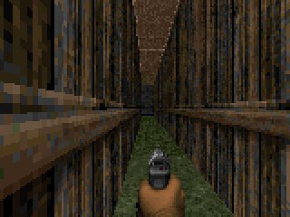](assets/videos/full/C0_sanity_10000.mp4) **C0 · sanity** | `C0_sanity_10000` | 62 | **exit** | 0 | 100% |
| [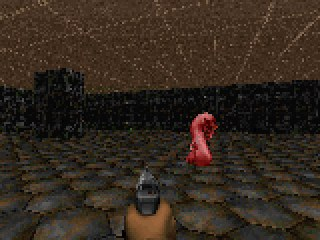](assets/videos/full/C1_duel_10000.mp4) **C1 · duel** | `C1_duel_10000` | 44 | **exit** | 0 | 100% |
| [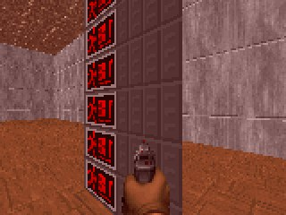](assets/videos/full/C2_arena_10001.mp4) **C2 · arena** | `C2_arena_10001` | 51 | **exit** | 0 | 100% |
| [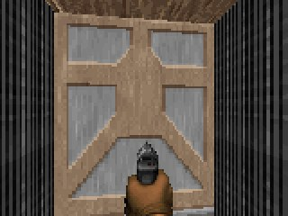](assets/videos/full/C3_corridor_door_10000.mp4) **C3 · corridor door** | `C3_corridor_door_10000` | 112 | **exit** | 0 | 100% |
| [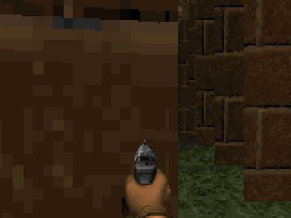](assets/videos/full/C4_room_door_10000.mp4) **C4 · room door** | `C4_room_door_10000` | 109 | **exit** | 0 | 67% |
| [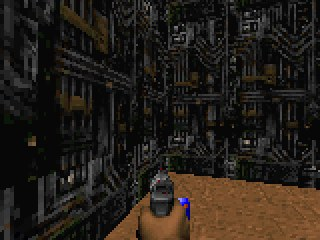](assets/videos/full/C5_key_lock_10000.mp4) **C5 · key → lock** | `C5_key_lock_10000` | 153 | **exit** | 0 | 83% |
| [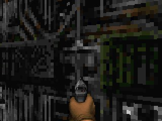](assets/videos/full/C6_two_key_10000.mp4) **C6 · two keys** | `C6_two_key_10000` | 179 | **exit** | 0 | 100% |
| [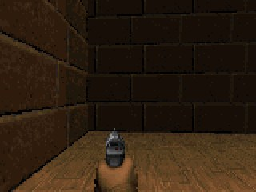](assets/videos/full/C7_exploration_10001.mp4) **C7 · exploration** | `C7_exploration_10001` | 431 | **exit** | 0 | 52% |
| [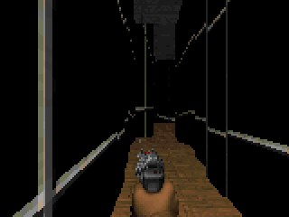](assets/videos/full/C8_backtrack_10000.mp4) **C8 · backtrack** | `C8_backtrack_10000` | 125 | **exit** | 0 | 100% |
| [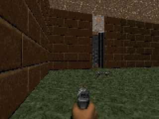](assets/videos/full/C9_ambush_10003.mp4) **C9 · ambush** | `C9_ambush_10003` | 1050 | timeout | 0 | 33% |
| [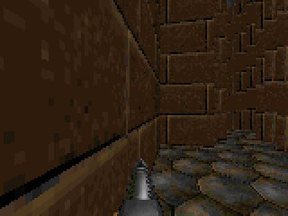](assets/videos/full/C10_resource_10003.mp4) **C10 · scarce ammo** | `C10_resource_10003` | 630 | **exit** | 0 | 18% |
| [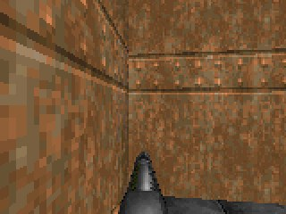](assets/videos/full/C11_gauntlet_10003.mp4) **C11 · gauntlet** | `C11_gauntlet_10003` | 1050 | timeout | 0 | 27% |
| [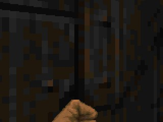](assets/videos/full/C12_freedoom_10002.mp4) **C12 · Freedoom** | `C12_freedoom_10002` | 1050 | timeout | 0 | 3% |
| [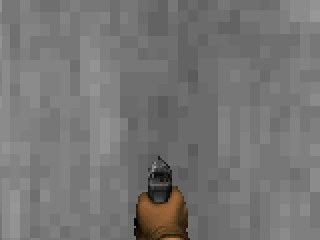](assets/videos/full/C13_ood_10002.mp4) **C13 · OOD** | `C13_ood_10002` | 1050 | timeout | 0 | 20% |

Click a poster to play the MP4. These are illustrative single episodes, not the
benchmark sample: on the categories where the agent exits, the clip is the first
exiting validation episode tried; on C9–C13 it is the best-proxy of four
attempts. The per-category rates, failures included, are in
[`RESULTS.md`](RESULTS.md).

The six shorter showcase clips used by the README (with GIF previews) are in
[`assets/videos/`](assets/videos/).

## Combat highlights

The clips above are picked for the fastest exit, and the fastest runs avoid
fights, so none of them shows a kill. The submitted agent does fight: on the
validation split (272 episodes) it scores 66 kills, with at least one kill in 36
episodes. These two clips are its highest-kill validation episodes (engine seed
0), chosen *for* kills, uncut:

| Clip | Map | Decisions | Outcome | Kills | Mapped |
|---|---|---|---:|---:|---:|
| [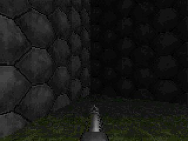](assets/videos/full/combat_C9_ambush_10001.mp4) **ambush** | `C9_ambush_10001` | 825 | death | 4 | 17% |
| [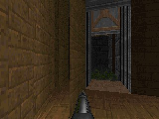](assets/videos/full/combat_C13_ood_10004.mp4) **OOD** | `C13_ood_10004` | 1050 | timeout | 3 | 29% |

Combat is the agent's weakest skill: it mostly wins by reaching the exit rather
than clearing rooms. A quick fine-tune with kills worth 2.5 instead of 0.6
(Stage E, `DF_KILL_REWARD=2.5`) added only 9 kills on validation and lowered the
overall score (−0.94), so it was not shipped.

## Re-record

```bash
uv sync --group train                      # adds torch + imageio
uv run python -m training.suite.generate --split val --n 10
uv run python -m tools.record_gallery      # writes assets/videos/full/
```

`record_gallery.py` runs the official `DoomAgent` through
`training.evaluate.run_agent_episode`, picks an episode per category, replays it
with frame capture and writes the MP4, the poster and `clips.json`.
